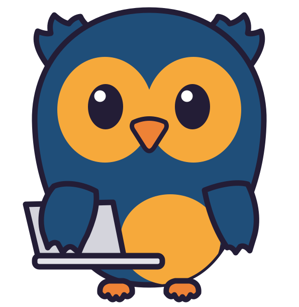
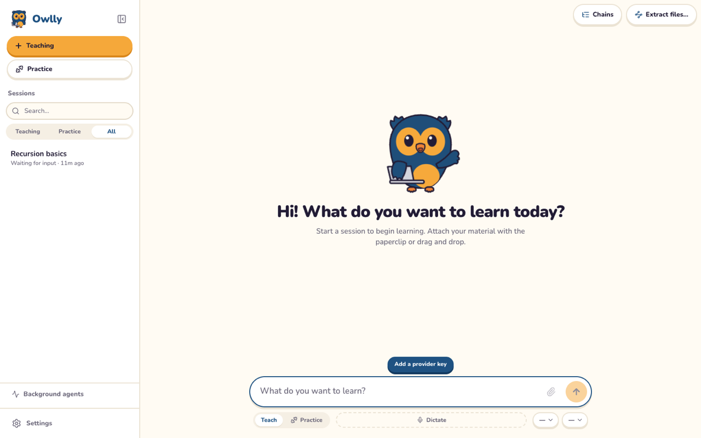
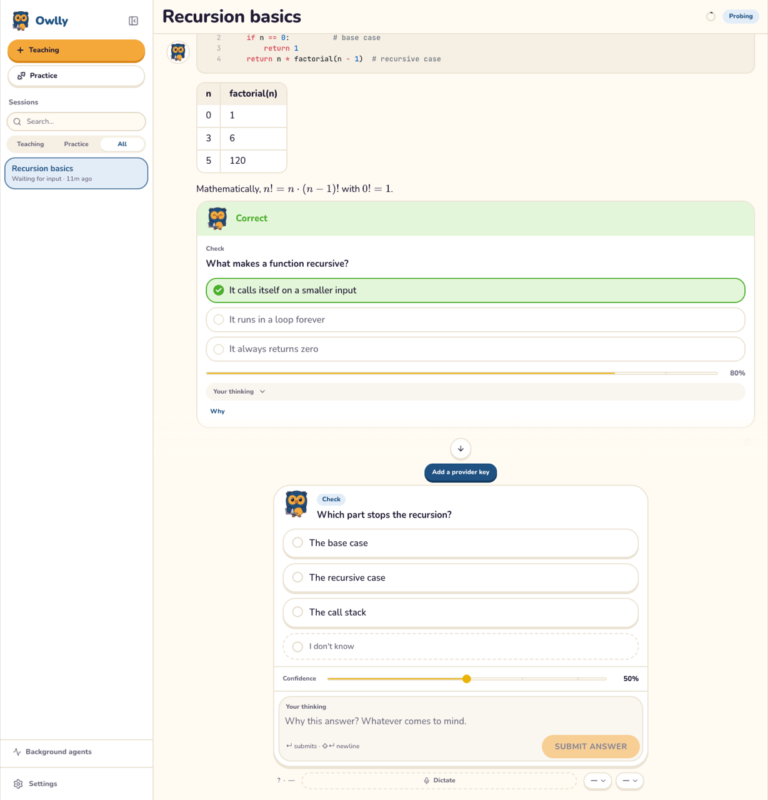

<p align="center">
  
</p>

<h1 align="center">Owlly</h1>

<p align="center"><strong>Learn anything with a patient owl tutor that remembers what you know.</strong></p>

Owlly uses AI agents to plan and teach lessons from your current understanding to your goal. It builds a detailed picture of what you understand and how you reason, and that picture is updated as you learn.

Instead of just giving you an explanation, Owlly uses your answers and thinking to decide what you need next. Teaching builds understanding one reasoning step at a time. Practice makes it usable. A persistent knowledge graph carries it across sessions.



## How it works

1. **Measure.** Before teaching, Owlly finds where your understanding ends on each part the lesson depends on. Your answers, confidence, and thinking show it where to start.
2. **Plan.** It works out a dependency map from that starting point to your goal. You can see the plan, and the lesson adapts when your understanding turns out different.
3. **Teach.** Each step builds on something you already understand. You predict, get an explanation, and check your understanding. Confusions are repaired before anything is built on them.
4. **Practice.** Separate sessions pose varied problems that require the right knowledge to come to mind without being named first. Problems and hints adapt to your reasoning.

**Think out loud.** The thinking fields let you explain your reasoning, uncertainties, and reactions in your own words, so Owlly gets a detailed picture rather than just a record of right and wrong answers. You can type or use dictation.

**Bring your files.** Attach material with the paperclip or drag it in.



## Knowledge that carries forward

What you are taught accumulates as propositions and reasoning chains: individual claims and the premises that lead to them. The graph shows this structure, with links back to the source sessions. You can also import notes.

Future teaching sessions can read the graph instead of starting from scratch, and practice sessions can draw their material from it. It stores ideas and their connections, not ratings of your ability.

## Your keys, your data

- **Your keys and models.** Billing depends on your provider, CLI configuration, subscription, or local setup. The live cost meter estimates known API costs, not subscription, CLI, or custom-endpoint charges.
- **Local storage.** Your chats, graph, settings, and API keys live on your machine as plain files you can inspect.
- **External services.** Models run through your configured providers. Model requests send the context needed for the task; web research and dictation also contact external services.
- **Inspectable behavior.** Built-in system prompts are available in the source code.

## Run it

```bash
npm ci
npm run plugins:setup
npm run dev        # http://localhost:3000
```

Pick your models in the first-run setup, then tell Owlly what you want to learn. You can use provider API keys, an installed [Claude Code CLI](docs/claude-code.md), or a [custom OpenAI-compatible endpoint](docs/custom-providers.md), including a local model server. See [Getting started](docs/getting-started.md) for model setup, dictation, files, and notes imports.

More: the [documentation index](docs/README.md), [development](docs/development.md), [architecture](docs/architecture.md), [keyboard shortcuts](docs/keyboard.md), [themes](docs/themes.md), and the [plugin authoring guide](docs/plugin-authoring.md).

## License

[AGPL-3.0](LICENSE).

